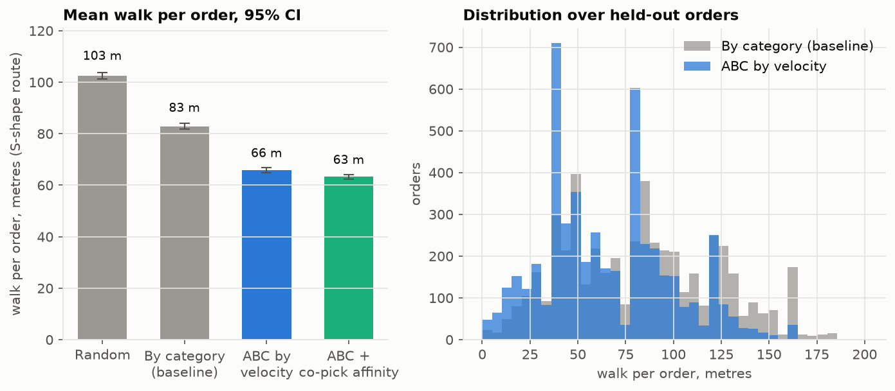
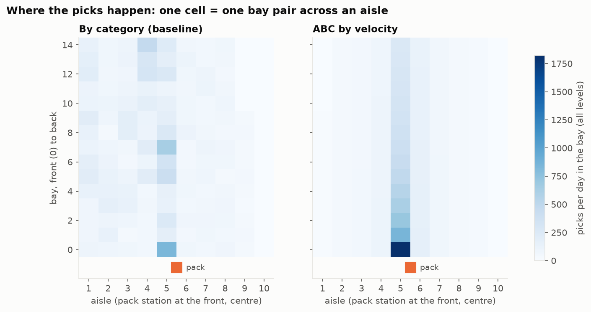
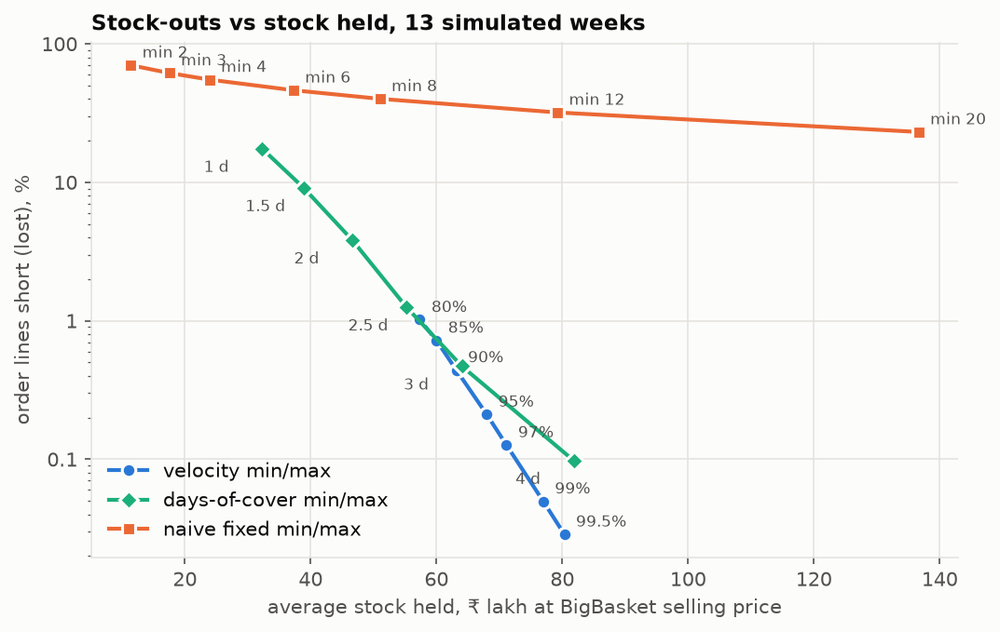
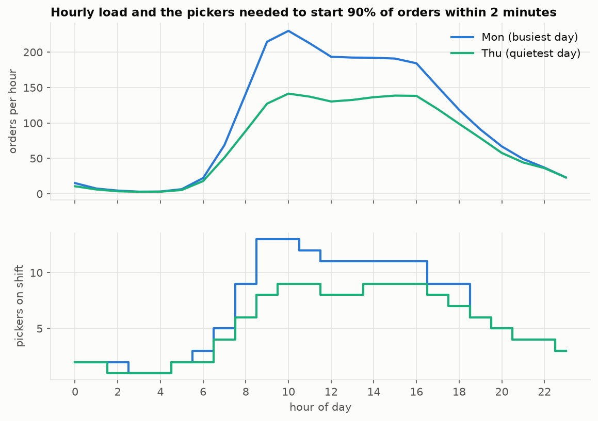
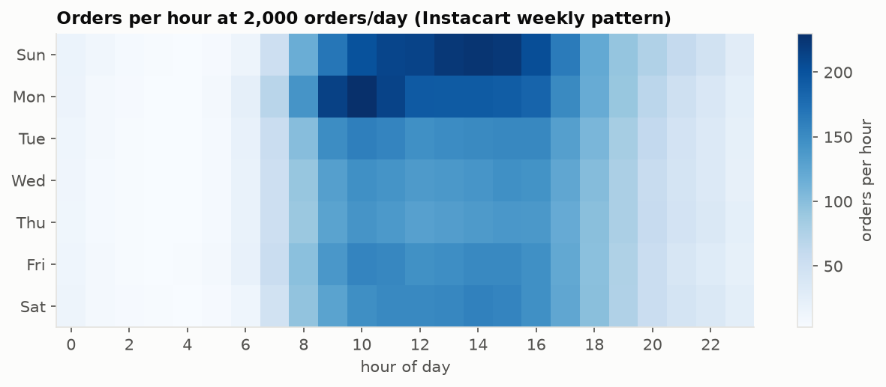

# Dark store operations simulator

A model of one quick-commerce dark store, built to answer four everyday
operations questions with numbers: where each product should sit, when to
reorder it from the warehouse, how many pickers to roster each hour, and how
to report the store's daily KPIs without a manual spreadsheet.

**Real Indian product range (BigBasket catalogue), real order-behaviour
patterns (Instacart, US), simulated dark store.** The order baskets, how often
products are bought together, and the hour and weekday of each order come from
3.3 million real Instacart orders. The products those orders are expressed in
are real BigBasket SKUs (atta, dal, paneer, curd, milk, namkeen, with rupee
prices). The store itself (racks, aisles, pack station, pickers, warehouse
lead time) is a model. Every number below is produced by `make all`.

## What each part solves

**Slotting: where each product sits.** In a dark store a picker walks the
aisles with a trolley for every order, and walking is most of the pick time.
If the products people buy most often are at the back or spread across every
aisle, every order pays for it. This part measures how often each SKU is
picked and which SKUs are bought together, then compares shelf layouts by
replaying real orders through them and measuring metres walked per order.

**Replenishment: when to reorder from the warehouse.** The store reorders
from a city warehouse (DC) every day. Hold too little and orders go out with
missing items; hold too much and money and shelf space sit idle. This part
sets a minimum (reorder point) and maximum for each SKU from its own demand
and how much that demand swings, then simulates three months of trading to
show how many order lines go short at each stock level, against simpler rules.

**Capacity: how many pickers each hour.** Orders do not arrive evenly. The
store needs enough pickers at 10 a.m. on a Monday that orders do not queue,
without paying idle pickers at 3 a.m. This part turns the hourly order pattern
and the measured pick time into a picker roster per hour, checks it with a
simulation, and finds the most orders per hour and per day the store can take
before pickers or pack stations become the limit.

**Automated KPIs: the daily ops report.** Store managers usually rebuild the
same numbers by hand each day. Here they are SQL views over the operations
log: orders per hour, pick time, walk distance, fill rate, stock-outs and
stock value, exported to CSV and Excel (opens in Google Sheets) and a static
HTML dashboard.

## Headline results

At 2,000 orders/day, with the numbers from the tables further down:

- Placing fast movers in the aisles nearest the pack station at waist height
  cuts walking by **20.6%** per order (95% CI 19.9% to 21.4%) and pick time by
  **12%** against a category-by-category layout. Also grouping items that are
  bought together raises the cut to **23.7%** walking and **13.6%** pick time.
- The faster picks save **111 picker-hours a week** (974 against 1,085) at the
  same service target, and lower the peak-hour picker need from 15 to 13.
- A per-SKU min/max at a 95% service level fills **99.79%** of order lines
  holding 3.6 days of stock. A days-of-cover rule with no safety stock needs
  about **17% more stock** to match that fill rate, and one fixed min/max for
  every SKU never gets above 77% even holding 1.6 times the stock.
- 13 pickers at the Monday 10:00 peak start 90% of orders within 2 minutes; the
  simulation confirms it after adding 5 picker-hours a week. With at most 16
  pickers on the floor and 6 pack stations the store tops out at about **306
  orders/hour, about 2,650 orders/day** on this weekly pattern.

## How to run

```bash
make setup     # creates .venv and installs requirements.txt (uses uv)
make data      # downloads both datasets from Kaggle into data/raw (needs a Kaggle API token)
make all       # build -> slotting -> replenishment -> capacity -> kpis -> report  (~40 s)
make test      # unit tests for routing, reorder logic, queueing, slotting and mapping
```

`make all` needs about 1.2 GB of RAM: DuckDB reads the 32 million order lines
straight from CSV. Each stage can also be run on its own (`make slotting`
etc.). Outputs land in `results/` (tables, KPI exports, dashboard), in
`docs/img/` (charts), and in the results section of this README.

Outputs to open:

- `results/dashboard.html`: the static KPI dashboard.
- `results/kpi/darkstore_kpis.xlsx` and `results/kpi/*.csv`: the daily, weekly,
  hourly, category and SKU stock-out KPIs for Google Sheets.
- `results/minmax_parameters.csv`: min and max per SKU at the chosen service level.
- `results/staffing_plan_by_hour.csv`: pickers per weekday and hour.
- `results/mapping_by_aisle.csv`: how each Instacart aisle mapped, and what it covers.

## Method

### Data and the product mapping

The Instacart Market Basket dataset has 3.4 million orders from about 206,000
US customers, with 49,688 products labelled by aisle (134) and department
(21), the sequence each item was added to the basket, and the weekday and
hour of each order. It has no dates and no quantities.

The BigBasket product list has 27,555 SKUs (25,636 after removing duplicates)
with category (11), sub-category (90), product type (426), brand and price in
rupees. It has no sales.

`config/aisle_to_bigbasket.csv` maps every Instacart aisle by hand to a
BigBasket category and sub-category, narrowed to product types where the
sub-category is broad. Examples: yogurt → Dairy (Curd, Yogurt & Shrikhand,
Buttermilk & Lassi); canned beans → Dals & Pulses (US shoppers buy canned beans
where Indian shoppers buy dal); jarred vegetables and pickled goods → Pickles &
Chutney; cottage cheese and tofu → Paneer, Tofu & Cream; trail mix → namkeen.
Alcohol, kosher and Latino foods, and Instacart's unlabelled products are
dropped. The pipeline refuses to run if an aisle is missing from the map or a
BigBasket SKU would sit in two mappings.

Inside each mapped group, Instacart products are taken from most to least
ordered. Each takes the free BigBasket SKU whose name shares the most words
with it, after dropping noise words such as "organic", folding plurals, and
translating a few US words (cilantro → coriander, half & half → cream, yogurt →
curd). If no name word matches, it takes the free SKU ranked highest by a
popularity proxy: rated SKUs first, by rating, then cheaper first. BigBasket
publishes no sales, so this proxy is weak. Where the group has more Instacart
products than BigBasket SKUs, the extra (least-ordered) products are dropped.

The store carries the 3,000 most-ordered mapped products. Order lines for
anything else are removed from the orders; 96% of orders keep at least one
line.

### 1. Slotting

**Store model.** One floor, 20 m × 18 m (360 m², about 3,900 sq ft). Ten pick
aisles, each 15 m long with a rack on both sides; 1.0 m walking aisle and
0.5 m rack depth, so aisle centres are 2.0 m apart. Cross aisles 1.5 m wide at
the front and back. Each rack face has 15 bays of 1.0 m, 6 shelf levels, 2
slots per shelf: 3,600 slots for 3,000 SKUs. Levels 2 to 4 are waist to
shoulder height. The pack station sits on the front cross aisle, centred.

**Standard times.** Walking 1.0 m/s with a trolley. Per order: 20 s to start
(read pick list, take totes) and 15 s to drop at the pack station. Per line:
7 s at waist height, 11 s at floor level or top shelf. One unit per line,
because Instacart has no quantities.

**Velocity and affinity.** Velocity is picks per day: a SKU's share of order
lines across Instacart's 3.2 million "prior" orders, times the store's 2,000
orders/day. Co-pick affinity is the number of orders per day containing both
SKUs of a pair, counted on 400,000 sampled orders.

**Layouts compared.**

- *Random*: each SKU in a random slot.
- *By category (baseline)*: SKUs grouped by BigBasket category and
  sub-category, filled aisle after aisle from the left wall. This is how a
  store is often set up on day one, with no use of sales data.
- *ABC by velocity*: SKUs sorted by velocity fill the aisles nearest the pack
  station first, waist-height levels first, then front to back. Whole aisles
  fill before the next ("within-aisle" storage), which suits S-shape routing
  because route length depends mainly on how many aisles an order enters.
- *ABC + co-pick affinity*: aisles fill nearest-first as above, but each slot
  goes to the SKU with the highest (picks per day + co-picks per day with the
  SKUs already in that aisle), so items bought together share an aisle.

**Routing.** S-shape (traversal): the picker enters every aisle with a pick,
walks it end to end, and if the number of such aisles is odd, enters the
last one from the front and comes back. Nearest-neighbour routing (always go
to the closest remaining pick) is reported alongside. Distances use the real
aisle geometry: between aisles the picker goes round by the front or the back
cross aisle, whichever is shorter.

**Evaluation.** Layouts are built from "prior" orders and tested on 5,000
orders from Instacart's separate "train" split, so the test orders were not
used to build the layouts. Every test order is routed through every layout.
Confidence intervals come from 2,000 bootstrap resamples of the orders.





### 2. Replenishment

**Daily demand.** Instacart orders have a weekday and hour but no date. A
calendar is built day by day: the number of orders that day is drawn from a
Poisson distribution with mean 2,000 × 7 × that weekday's share of Instacart
orders, and that many real orders, with their baskets and hours, are drawn at
random from Instacart orders placed on the same weekday. A SKU's daily demand
is its line count across that day's orders. So demand keeps Instacart's
weekday pattern, basket mix and co-purchase structure, but day-to-day swings
come from random sampling, not from real promotions, weather or trends.

**Policy.** Each SKU is reviewed once a day after closing. Stock ordered
tonight arrives from the DC tomorrow night (lead time L = 1 day), so it is on
the shelf the day after tomorrow, and the minimum has to cover P = L + R =
2 days. With mean μ and standard deviation σ of daily demand from the first 56
days:

- min (reorder point) s = ⌈μP + zσ√P⌉, with z from the service level;
- max S = s + max(1, ⌈2μ⌉), about two days of extra cover;
- when stock on hand plus stock on order is at or below s, order up to S.

The policy then runs for 91 days on fresh demand. Within a day, order lines
take stock in time order. When a SKU runs out, the remaining lines for it that
day are short (lost, not back-ordered). The KPI log uses the 95% policy.

**Baselines.** *Same for every SKU*: one min and max for all SKUs (min k, max
2k units), which ignores velocity. *Days of cover*: min = k days of mean demand,
same max cover as above, which uses velocity but no safety stock for
variability.



**What the daily log shows.** Line fill dips every Monday (99.4% on average,
99.0% on the worst one, against about 99.9% from Wednesday to Saturday). The
min uses one mean for all weekdays, but Instacart's Sunday and Monday each run
about 21-23% above the weekly average, so two heavy days in a row drain the
shelf before the DC delivery lands. A weekday-aware min (the sum of the next two days' weekday means)
is the obvious next step. The daily trend chart is in the dashboard and at
`docs/img/kpi_daily.png`.

### 3. Capacity

**Load.** Orders per hour for every weekday and hour come from all 3.3
million Instacart orders, scaled to 2,000 orders/day.

**Staffing.** Each hour is treated as an M/M/c queue: orders arrive at random
at the hour's rate, pickers are the c servers, and the mean service time is
the simulated pick time per order (2.72 min on the ABC layout). The roster
for each hour is the smallest c for which Erlang C gives P(wait > 2 min) ≤ 10%.
Erlang C assumes exponential pick times; the real ones vary less
(coefficient of variation about 0.47), so it is on the safe side for a
steady hour.

**Check by simulation.** A SimPy discrete-event model replays four weeks:
arrivals at each hour's rate, pick times drawn from the 5,000 routed orders,
the roster changing each hour (a picker going off shift finishes the order in
hand), then a pack station (60 s per order, 6 stations). Erlang C is a
steady-state formula and lags when load climbs hour to hour, so any busy
hour that misses the target in the simulation gets one more picker and the
simulation re-runs, until every busy hour meets the target.

**Throughput limit.** The store's ceiling is the lower of: the most orders
per hour 16 pickers can take while meeting the wait target (more pickers than
that congest ten aisles), and what 6 pack stations clear at 85% utilisation.
Dividing by the peak hour's share of a day gives the most orders per day the
store can take on Instacart's weekly pattern.





### 4. Automated KPIs

The replenishment run writes an operations log: every simulated order (date,
hour, lines, walk metres and pick seconds on the ABC layout), every order line
(short or not), and every SKU-day of stock (opening, demand, served, closing,
ordered from the DC). `sql/kpi_views.sql` defines the views a store would put
on its WMS tables:

| View | One row per | Main columns |
|---|---|---|
| `kpi_daily` | day | orders, lines per order, peak orders/hour, avg and p90 pick time, avg walk, line fill rate, perfect-order rate, SKUs with lost sales, SKUs at zero, closing stock value, DC order lines and units |
| `kpi_weekly` | week | the same, rolled up with the right weights |
| `kpi_hourly` | day × hour | orders, avg pick time, avg walk |
| `kpi_category_daily` | day × category | lines, short lines, fill rate |
| `kpi_sku_stockouts` | SKU | days with lost sales, lost units, lost sales in ₹ |

`make kpis` exports each view to CSV, writes all five to one Excel workbook,
and builds `results/dashboard.html`: a single self-contained page with KPI
tiles, the last 14 days, weekly and category tables, the SKUs losing the most
sales, and the charts.

## Results

Generated by `make all` (the `report` stage rewrites this section).

<!-- results:start -->
### Product mapping (Instacart → BigBasket)

| Item | Value |
|---|---|
| Instacart aisles mapped to a BigBasket category | 125 of 134 |
| Instacart departments fully mapped | 17 of 21 (partly: international; dropped: alcohol, missing, other) |
| Aisles dropped (no Indian counterpart or unlabelled) | beers coolers, kosher foods, latino foods, missing, other, red wines, specialty wines champagnes, spirits, white wines |
| Order lines in dropped aisles | 1.1% |
| Order lines on Instacart products beyond BigBasket's range depth | 17.5% |
| Order lines on mapped products outside the 3,000-SKU store range | 11.2% |
| Order lines the store range covers | 70.2% |
| Orders with at least one line in the range | 3,215,417 of 3,346,083 |
| BigBasket categories / sub-categories in the store | 11 / 60 |
| Store SKUs matched to a BigBasket SKU by a shared name word | 2,153 of 3,000 (74.0% of store picks) |


### 1. Slotting (5,000 held-out orders, 7.5 lines each on average)

| Layout | Walk / order, m (S-shape) | Walk / order, m (nearest-neighbour) | Pick time / order, min | Aisles visited / order | Picks at waist height | Walk cut vs baseline (95% CI) | Pick-time cut vs baseline (95% CI) |
|---|---|---|---|---|---|---|---|
| Random placement | 102.5 | 88.1 | 3.42 | 4.73 | 49% | -23.6% (-24.5% to -22.7%) | -10.7% (-11.2% to -10.3%) |
| By category (baseline) | 82.9 | 72.7 | 3.09 | 3.88 | 51% | — | — |
| ABC by velocity | 65.8 | 58.4 | 2.72 | 3.24 | 67% | 20.6% (19.9% to 21.4%) | 12.0% (11.6% to 12.3%) |
| ABC + co-pick affinity | 63.3 | 56.6 | 2.67 | 3.13 | 69% | 23.7% (23.0% to 24.4%) | 13.6% (13.2% to 13.9%) |


Paired difference, ABC by velocity minus baseline: -17.1 m per order (95% CI -17.8 to -16.3). ABC classes: A = 1,193 SKUs, 80% of picks, B = 1,147 SKUs, 15% of picks, C = 660 SKUs, 5% of picks.


### 2. Replenishment (91 simulated days after 56 days of history, ~1,999 orders/day, lead time 1 day, daily review)

| Policy | Line fill rate | Orders complete | SKU-days with lost sales | Avg stock, units | Avg stock, ₹ lakh | Days of cover | DC order lines / day |
|---|---|---|---|---|---|---|---|
| Min/max, 80% service level | 98.98% | 94.0% | 1.86% | 44,856 | 57.3 | 3.0 | 1,081 |
| Min/max, 85% service level | 99.28% | 95.5% | 1.39% | 46,744 | 60.0 | 3.2 | 1,085 |
| Min/max, 90% service level | 99.56% | 97.1% | 0.92% | 49,141 | 63.2 | 3.3 | 1,088 |
| Min/max, 95% service level | 99.79% | 98.5% | 0.49% | 52,643 | 68.0 | 3.6 | 1,091 |
| Min/max, 97% service level | 99.87% | 99.1% | 0.32% | 54,960 | 71.1 | 3.7 | 1,092 |
| Min/max, 99% service level | 99.95% | 99.6% | 0.14% | 59,276 | 77.0 | 4.0 | 1,093 |
| Min/max, 99.5% service level | 99.97% | 99.8% | 0.08% | 61,718 | 80.3 | 4.2 | 1,093 |
| Same for every SKU: min 2, max 4 | 29.89% | 6.9% | 44.83% | 6,981 | 11.4 | 0.5 | 1,576 |
| Same for every SKU: min 3, max 6 | 38.44% | 10.1% | 33.66% | 10,735 | 17.5 | 0.7 | 1,351 |
| Same for every SKU: min 4, max 8 | 44.84% | 12.8% | 26.24% | 14,642 | 23.9 | 1.0 | 1,192 |
| Same for every SKU: min 6, max 12 | 53.77% | 17.6% | 17.33% | 22,788 | 37.2 | 1.5 | 969 |
| Same for every SKU: min 8, max 16 | 59.91% | 21.8% | 12.57% | 31,219 | 51.0 | 2.1 | 828 |
| Same for every SKU: min 12, max 24 | 68.04% | 28.1% | 7.68% | 48,513 | 79.2 | 3.3 | 646 |
| Same for every SKU: min 20, max 40 | 76.90% | 37.4% | 3.92% | 83,965 | 136.6 | 5.7 | 452 |
| Days of cover: min = 1 d | 82.48% | 44.4% | 18.38% | 25,426 | 32.3 | 1.7 | 926 |
| Days of cover: min = 1.5 d | 90.87% | 65.7% | 11.23% | 30,733 | 38.9 | 2.1 | 994 |
| Days of cover: min = 2 d | 96.18% | 82.0% | 6.05% | 36,948 | 46.6 | 2.5 | 1,041 |
| Days of cover: min = 2.5 d | 98.75% | 92.3% | 2.84% | 44,019 | 55.2 | 3.0 | 1,070 |
| Days of cover: min = 3 d | 99.53% | 96.8% | 1.32% | 51,302 | 64.0 | 3.5 | 1,084 |
| Days of cover: min = 4 d | 99.90% | 99.3% | 0.31% | 65,867 | 81.8 | 4.5 | 1,092 |


At about the same stock, the 95% min/max loses 0.21% of lines against 0.47% for a 3-day cover rule. To reach the same fill rate, the days-of-cover rule needs about 61,439 units (+17% stock).


### 3. Capacity (2,000 orders/day, target: 90% of orders start picking within 2 min)

| Item | Value |
|---|---|
| Peak hour | Mon 10:00, 230 orders/hour |
| Mean pick time (ABC layout / baseline layout) | 2.72 / 3.09 min |
| Pickers needed at peak, Erlang C (ABC / baseline) | 13 / 15 |
| Picker-hours per week, Erlang C (ABC / baseline) | 974 / 1,085 |
| Orders per picker-hour (ABC / baseline) | 14.4 / 12.9 |
| Picker-hours per week after the SimPy check | 979 (+5 over Erlang C) |
| SimPy: orders starting within target | 98.3% |
| SimPy: mean / 90th percentile wait for a picker | 0.21 / 0.82 min |
| SimPy: mean / 90th percentile order-to-packed time | 3.9 / 5.8 min |
| Throughput limit, pickers (max 16 on the floor) | 306 orders/hour |
| Throughput limit, pack stations (6 at 60 s, ≤85% busy) | 306 orders/hour |
| Binding limit | pickers: 306 orders/hour |
| Max orders/day with this weekly pattern | 2,657 |


Planning grid (peak-day and new-store sizing, ABC layout):

| Orders/day | Peak orders/hour | Pickers at peak | Picker-hours/day | Fits this store |
|---|---|---:|---|---|
| 1,000 | 115 | 8 | 87 | yes |
| 1,500 | 173 | 10 | 113 | yes |
| 2,000 | 230 | 13 | 139 | yes |
| 2,500 | 288 | 16 | 163 | yes |
| 3,000 | 345 | 18 | 188 | no |
| 4,000 | 460 | 24 | 235 | no |
| 5,000 | 575 | 29 | 281 | no |


### 4. KPI snapshot (last simulated week, from the SQL views)

| KPI | Value |
|---|---|
| Orders / day | 1,992 |
| Peak orders / hour | 237 |
| Avg pick time | 2.69 min |
| Avg walk | 65 m |
| Line fill rate | 99.81% |
| Perfect orders | 98.7% |
| SKUs with lost sales | 14 / day |
| Stock on hand | ₹68.5 lakh |
<!-- results:end -->

## Assumptions and limitations

- **US behaviour on Indian products.** Basket sizes, purchase frequency, what
  is bought together and the hourly pattern are those of Instacart customers
  in the US in 2017. Indian quick-commerce baskets are smaller (often 3 to 5
  items), peak in the evening rather than late morning, and lean more on milk,
  bread, vegetables and staples. The fast movers here are fast because
  Instacart customers bought bananas, berries and avocados; the BigBasket
  names on them are a mapping, not Indian sales.
- **The mapping is approximate.** About a quarter of store picks sit on a
  BigBasket SKU chosen by the weak rating-and-price proxy because no name
  matched (strawberries have no BigBasket counterpart and land on sugarcane,
  for example). Products beyond a BigBasket group's depth are dropped (17.5%
  of Instacart lines). Prices are BigBasket selling prices, so stock values
  are at retail, not cost.
- **The layout is modelled, not measured.** Dimensions, walking speed and
  standard times are reasonable assumptions, not time-and-motion data from a
  real store. Picker congestion is not modelled: ABC slotting puts the
  heaviest traffic in the centre aisles, and a real store would spread its A
  items over two or three aisles to keep pickers out of each other's way.
  One unit per line; no batching of several orders per pick trip.
- **Demand timing is approximated.** Instacart has no dates, so daily demand
  is resampled from real orders by weekday. There is no trend, seasonality
  beyond the week, promotion or festival peak, so the safety stocks here are
  lower than a real store would need. Demand is treated as independent day
  to day and roughly normal over two days, which is weak for slow movers.
- **Replenishment ignores some real limits:** DC stock-outs, truck capacity,
  case-pack rounding, shelf capacity per slot, shrinkage and expiry, and the
  system-vs-shelf count errors that cycle counting exists to catch. Lead time
  is a fixed day.
- **Capacity covers pickers and packing only.** Riders, the inbound dock and
  put-away labour are outside the model. The store is assumed open 24 hours
  with at least one picker on shift; Instacart has a small overnight load.

## Repository layout

```
config/aisle_to_bigbasket.csv   hand-written Instacart aisle -> BigBasket mapping
dso/config.py                   every assumption (layout, times, volumes, service levels)
dso/sources.py                  data adapters: Instacart order source, BigBasket catalogue
dso/mapping.py                  product mapping
dso/layout.py, routing.py       slot grid, S-shape and nearest-neighbour routing
dso/slotting.py                 velocity, ABC classes, layouts, per-order walk and pick time
dso/replenishment.py            min/max policy and the order-level inventory simulation
dso/capacity.py                 Erlang C staffing and the SimPy model
dso/kpis.py, sql/kpi_views.sql  KPI views, CSV/Excel export, HTML dashboard
dso/pipeline.py                 the stages run by make
dso/report.py                   writes results/summary.md and the README results
tests/                          unit tests
```

The order source and the catalogue are behind two small adapter classes in
`dso/sources.py`. Another order history or catalogue (for example real store
data) needs one new class with the same methods and a mapping file.

## Data and licences

- Instacart Market Basket Analysis, via Kaggle
  (`yasserh/instacart-online-grocery-basket-analysis-dataset`, a copy of the
  2017 Instacart release). Used under Instacart's terms for non-commercial use.
- BigBasket Entire Product List (Kaggle, `surajjha101/bigbasket-entire-product-list-28k-datapoints`),
  licensed **CC BY-NC-SA 4.0**. The files in `results/` that contain BigBasket
  product names and prices are derived from it and are shared under the same
  licence, with attribution to the dataset's author.

Raw data is not in this repository (`data/` is git-ignored); `make data`
downloads it. The code is MIT-licensed (see `LICENSE`).
